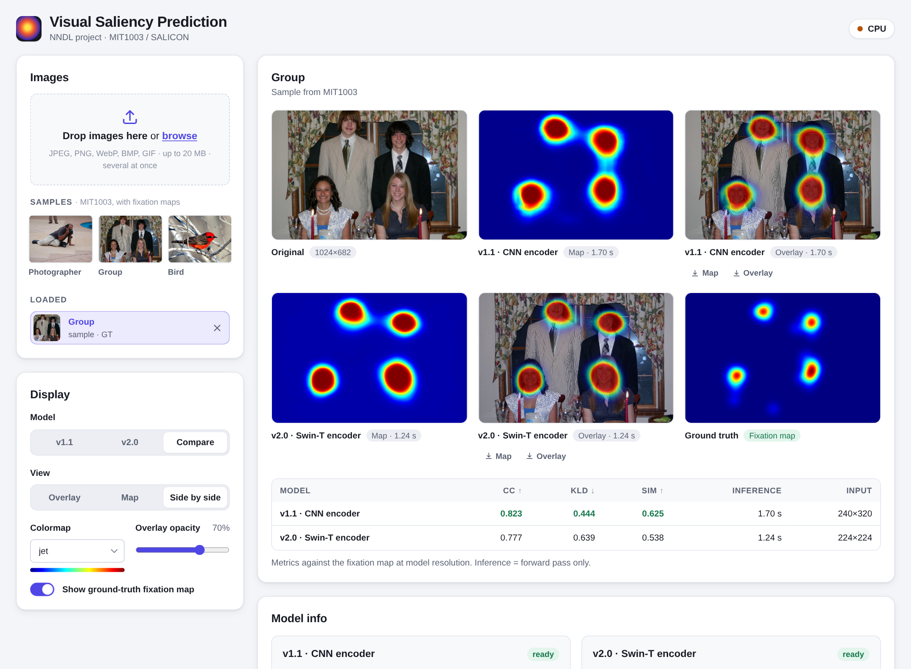

# Visual saliency prediction

Predicting where people look in an image with deep networks. Project for the *Neural Networks
and Deep Learning* course (University of Padova), based on
[Wang & Shen, *Deep Visual Attention Prediction*](https://arxiv.org/abs/1705.02544).

Two models, trained on [SALICON](http://salicon.net/) and tested on
[MIT1003](http://people.csail.mit.edu/tjudd/WherePeopleLook/), both with the same
deep-supervision decoder and a loss that combines KL divergence, correlation coefficient and
similarity:

| | encoder | input | params | MIT1003 CC ↑ | KLD ↓ | SIM ↑ |
|---|---|---|---|---|---|---|
| **v1.1** | VGG-style CNN, trained from scratch | 240×320 | 15.1 M | 0.604 | 0.923 | 0.481 |
| **v2.0** | Swin-Tiny transformer (ImageNet init) | 224×224 | 27.9 M | 0.593 | 0.944 | 0.461 |

MIT1003 is never used for training, so the numbers measure generalisation. The two models end up
very close; the full discussion is in the report,
[*From a Scratch CNN to a Pretrained Transformer Encoder*](docs/report.pdf).



## Try it

A local web app runs both models on your images or on bundled samples, with overlay / map /
side-by-side views, model comparison, colormaps and CC / KLD / SIM against a fixation map.
Everything stays on your machine, no GPU needed (about 1 s per image on CPU).

```bash
python -m venv .venv && source .venv/bin/activate
pip install torch torchvision --index-url https://download.pytorch.org/whl/cpu   # CUDA / macOS: see docs/usage.md
pip install -r requirements.txt
python -m app        # opens http://localhost:7860
```

Trained weights are in [`weights/`](weights) (fp16 safetensors). More in
[docs/usage.md](docs/usage.md): requirements, GPU, weights, evaluation, tests.

## Repository

```
notebooks/   training and evaluation on Colab: v1.1.ipynb, v2.0.ipynb
             archive/ earlier attempts: beta (paper as is, MSE), v1.0 (Adam, BatchNorm, new loss)
saliency/    model code, weights loading, inference, metrics
app/         FastAPI server + static frontend (no build step)
weights/     trained models + MANIFEST.json (sizes, sha256)
samples/     8 MIT1003 images with fixation maps
tools/       weight conversion, MIT1003 evaluation
tests/       pytest suite
docs/        report.pdf, usage.md, gui.md (architecture, standalone roadmap), project-history.md
```

## Reproducing the training

Open `notebooks/v1.1.ipynb` or `notebooks/v2.0.ipynb` in Google Colab (we trained on a single
T4). They mount Google Drive and expect the datasets as zip files in `MyDrive/NN_DL_Proj/DB/`:
SALICON zips that extract to `images/{train,val}` and `maps/{train,val}`, and MIT1003 as
`DB/MIT_DATASET/ALLSTIMULI.zip` and `ALLFIXATIONMAPS.zip`; checkpoints are saved in
`MyDrive/NN_DL_Proj/<version>/snapshots/`. The training procedure, hyper-parameters and
results are described in the [report](docs/report.pdf); the story of how we got from the
paper to v2.0 is in [docs/project-history.md](docs/project-history.md).

## Credits

- Authors: Simone Freschet, Sebastiano Colombini.
- Datasets: SALICON (Jiang et al., CVPR 2015) and MIT1003 (Judd et al., ICCV 2009). The
  sample images in `samples/` come from MIT1003, see [samples/SOURCES.md](samples/SOURCES.md).
- Base architecture: W. Wang and J. Shen, *Deep Visual Attention Prediction*, IEEE TIP 2018.
